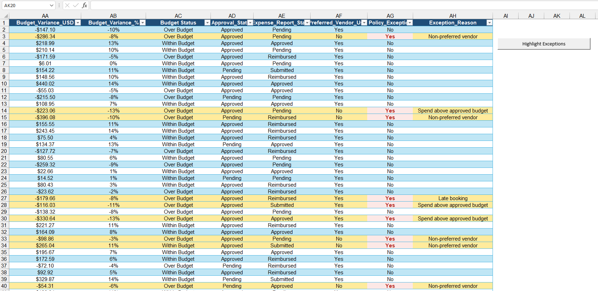
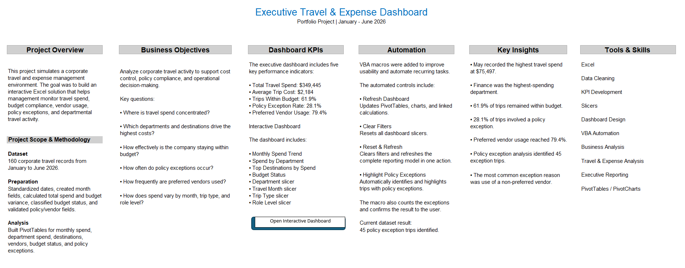

# Executive Travel & Expense Dashboard

Interactive Excel dashboard with VBA automation for corporate travel and expense analysis.

This portfolio project simulates a corporate travel and expense management environment and demonstrates how Excel, PivotTables, slicers, KPI reporting, and VBA automation can be combined to support cost control, policy compliance, and executive decision-making.

---

## Dashboard Preview

---

## Business Objective

The purpose of this project was to create an interactive reporting solution that helps management understand corporate travel activity and answer key operational questions:

- Where is travel spend concentrated?
- Which departments generate the highest travel costs?
- Which destinations represent the greatest spend?
- How effectively is the company staying within budget?
- How frequently do policy exceptions occur?
- How often are preferred vendors used?
- How does travel activity vary by month, trip type, department, and role level?

---

## Key Performance Indicators

- **Total Travel Spend:** $349,445
- **Average Trip Cost:** $2,184
- **Within Budget:** 61.9%
- **Policy Exception Rate:** 28.1%
- **Preferred Vendor Usage:** 79.4%
- **Policy Exception Trips:** 45

---

## Key Insights

- May recorded the highest travel spend at **$75,497**
- Finance was the highest-spending department
- **61.9%** of trips remained within budget
- **28.1%** of trips included a policy exception
- Preferred vendor usage reached **79.4%**
- **45 policy exception trips** were identified
- The most common exception reason was **Non-preferred vendor**

---

## Dashboard Features

The dashboard includes:

- 5 executive KPI cards
- Monthly Spend Trend
- Spend by Department
- Top Destinations by Spend
- Budget Status analysis
- Department slicer
- Travel Month slicer
- Trip Type slicer
- Role Level slicer

The dashboard is fully interactive and allows users to filter the reporting view dynamically.

---

## VBA Automation

VBA macros were added to improve usability and automate recurring tasks.

### Refresh Dashboard
Refreshes PivotTables, charts, and linked calculations.

### Clear Filters
Resets all slicers and returns the dashboard to its default view.

### Reset & Refresh
Clears dashboard filters and refreshes the reporting model in a single action.

### Highlight Policy Exceptions
Automatically identifies and highlights trips with policy exceptions.

The macro also counts the number of exception records and confirms the result to the user.

---

## Policy Exception Review

This automation helps users quickly identify transactions that require further review, including:

- Non-preferred vendor usage
- Spend above approved budget
- Late booking
- Other policy-related exceptions

---

## Project Overview

The workbook includes a dedicated Project Overview sheet summarizing:

- Business objectives
- Project methodology
- Dashboard KPIs
- VBA automation
- Key insights
- Tools and skills demonstrated

---

## Tools Used

---

## Skills Demonstrated

- Advanced Excel
- Data Cleaning
- KPI Development
- PivotTables
- PivotCharts
- Interactive Dashboards
- VBA Automation
- Business Analysis
- Travel & Expense Analysis
- Executive Reporting
- Policy Compliance Analysis
- Vendor Performance Monitoring

---

## Dataset

The project contains **160 simulated corporate travel records** covering activity from **January through June 2026**.

The dataset includes information related to:

- Employee and department
- Travel dates
- Destination
- Trip type
- Role level
- Actual travel spend
- Budget
- Budget variance
- Approval status
- Expense report status
- Preferred vendor usage
- Policy exceptions
- Exception reasons

---

## Workbook Structure

The Excel workbook includes the following main worksheets:

- **Project Overview**
- **Travel_Expense_Data**
- **Pivot_Analysis**
- **Dashboard**
- **Data Dictionary**

---

## How to Use the Workbook

1. Download the `.xlsm` file from this repository.
2. Open the workbook using the desktop version of Microsoft Excel.
3. Enable macros when prompted.
4. Navigate to the **Dashboard** worksheet.
5. Use the slicers to filter the reporting view.
6. Use the dashboard controls to refresh data or clear filters.
7. Open the **Travel_Expense_Data** worksheet to run the policy exception highlighting macro.

> VBA macros require Microsoft Excel desktop with macros enabled.

---

## Download the Project

[Download the Excel Dashboard](./Executive_Travel_Expense_Dashboard_Portfolio.xlsm)

---

## Project Type

**Portfolio Project — Travel & Expense Management Analytics**

This project was created to demonstrate practical business analytics, operational reporting, dashboard design, and Excel automation capabilities.
